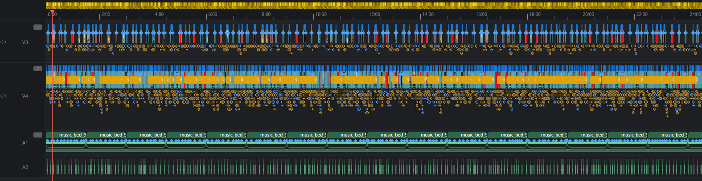
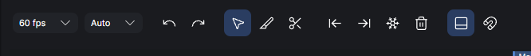
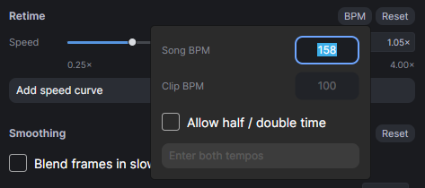
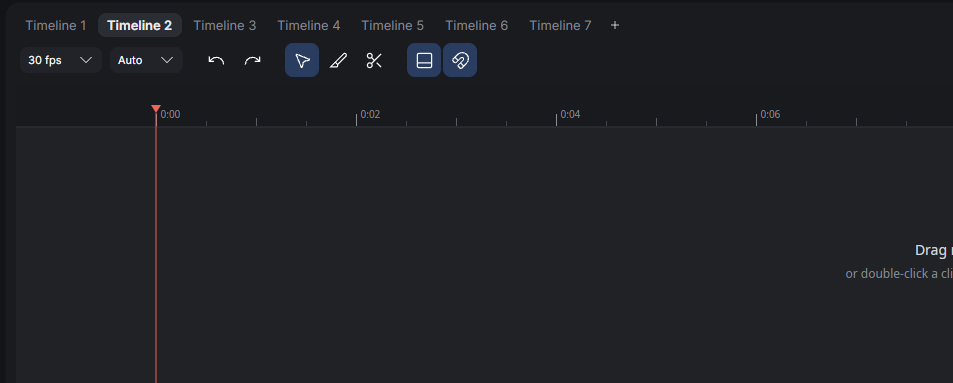
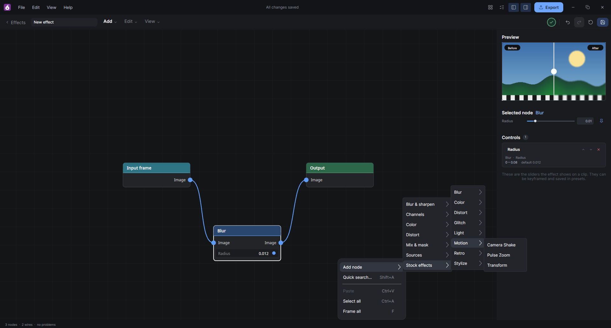

## 10/24/26

Fig has been optimized to render thousands of times more clips while compositing simultaneously.

Panning and zooming are also optimized.

### New toolbar

The toolbar has been redesigned to look sleeker, but is also adaptive and shows icons in-context (when needed).

### Match videos to track bpm

### Create multiple timelines

### Effects graph presets (t-parametric effects coming soon)

You can create custom effects mixtures with the graph editor.

