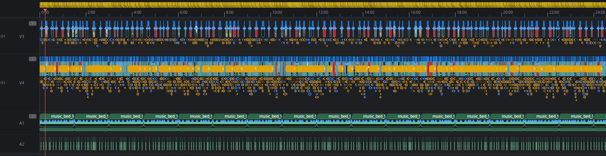
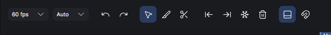
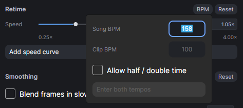
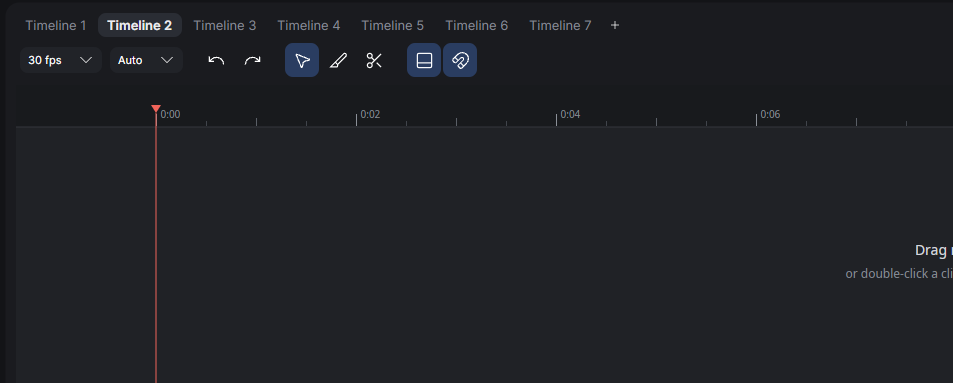
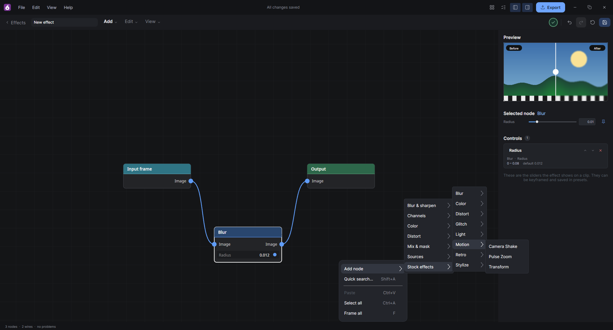

## 10/24/26

Fig has been optimized to render thousands of times more clips while compositing simultaneously.

Panning and zooming are also optimized.

### New toolbar

The toolbar has been redesigned to look sleeker, but is also adaptive and shows icons in-context (when needed).

### Match videos to track bpm

### Create multiple timelines

### Effects graph presets (t-parametric effects coming soon)

You can create custom effects mixtures with the graph editor.

## 11/10/26

Fig has been ported from C#/Avalonia to Rust/Rune with Claude Opus 5.5.

Why? I am more proficient with Rust and have used it longer than C#. It's easier to model with structs than having to utilize interfaces, static classes, etc etc. Sounds like a skill issue, but I've always prefered simpler languages that prevent me from slipping up.

Secondly, Rune allows me to compose UI elements into widgets that I can utilize like lego blocks. In Avalonia, I had to utilize the MVVM pattern to handle stateful interaction between the UI elements and models.

Ultimately, the transition will make it easier to add new features by hand, and greatly improves code readability for me.

The GPU rendered visuals also make the UI exceedingly faster than the previous version.
