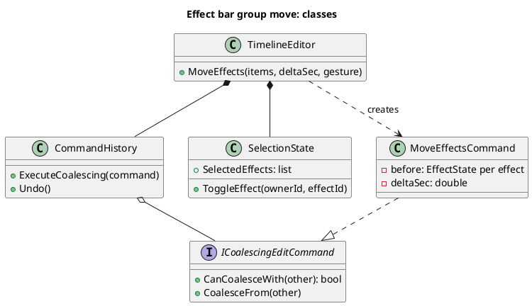
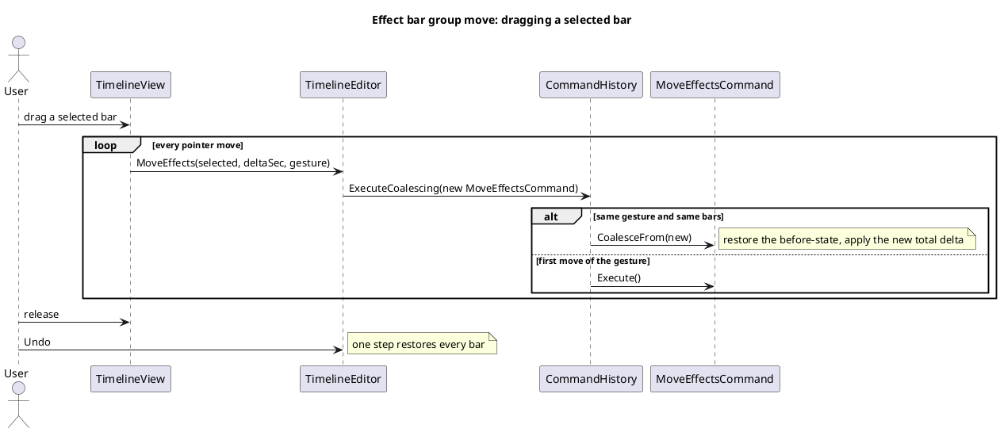

# Contributing to Fig

Thanks for helping. Fig is a deliberately small editor ("simple, like CapCut"), so the most useful contributions are the ones that keep it that way: focused, understood, and designed before they are built.

## The one rule: design before you build any large subsystem (excludes small features)

**Before any major feature is implemented, its UML must exist and be part of the same pull request (or an earlier one).**

Two diagrams are required. Nothing more is needed for now.

1. **A simple class diagram** of the types the feature adds or changes, and how they relate.
2. **A sequence diagram** that walks through the implementation: who calls whom, in what order, for the main user action.

The order of work is:

1. **UML first.** Write the two diagrams.
2. **Implementation.** Build the headless code in `Fig.Core` (no UI dependencies).
3. **Tests.** Cover the core behaviour before any UI exists.
4. **UI last.** The interface is built on top of a backend that already works.

If the diagrams are hard to draw, the design is not ready yet. That is the point of drawing them.

### What counts as a "major feature"

Needs UML:

- A new subsystem, module, or pipeline stage (for example an effect graph, a new export path, a new kind of selection).
- A new editing command family, or a change to how the timeline model or undo history works.
- Anything that adds a new concept to the project file format (like an Audio Mixer)
- Anything that touches more than one of `Fig.Core`'s modules.

Does **not** need UML:

- Bug fixes and small tweaks.
- New effects and transitions that follow the existing pattern (see [DEVELOPMENT.md](DEVELOPMENT.md)).
- Refactors that do not change behaviour, and docs-only changes.

If you are unsure, open an issue and ask before writing code.

### Where the diagrams go

Diagrams are [PlantUML](https://plantuml.com), stored next to the rendered image, in the folder for the module they belong to:

```
uml/
  domain/       timeline model, editing commands
  media/        decoding, effects, transitions, analysis
  playback/     playback engine
  export/       export pipeline
  input/        gestures and key bindings
  persistence/  project files, import
  templates/
```

Name them after the feature and keep the pair together:

```
uml/media/my-feature-schema.puml      <- class diagram
uml/media/my-feature-schema.png
uml/media/my-feature-sequence.puml    <- sequence diagram
uml/media/my-feature-sequence.png
```

Render with `plantuml -tpng uml/media/my-feature-*.puml` and commit both the `.puml` and the `.png`. Edit the existing diagram instead of adding a new one when your change extends something already drawn there. Diagrams must match the code when you finish: if the implementation changed shape along the way, update the UML.

### What the two diagrams should look like

Keep them small. They are for understanding, not decoration.

**Class diagram.** Only the types that matter to the feature: the new ones, and the existing ones they attach to. Show the key members, the relationships (composition, creates, implements), and nothing else.



**Sequence diagram.** One main user action, from the input to the result, including undo if the feature is editable. Show the real class and method names you intend to use, and the interesting branches.



Existing diagrams in `uml/` (for example `uml/media/fade-sequence.puml`) are good references for style.

## Getting set up

Requirements: .NET SDK 10.0 or later, and a desktop platform supported by Avalonia (Windows, macOS, Linux). To run with sound you also need an audio output device. [PlantUML](https://plantuml.com/starting) is needed to render diagrams.

```bash
dotnet build
dotnet run --project src/Fig.App
dotnet test
```

## Code layout and conventions

- `src/Fig.Core` is the engine and has **no UI dependency**. Behaviour belongs here and is unit tested.
- `src/Fig.App` is the Avalonia application: views, view models, services. Keep logic out of views; they call into Core.
- Tests live in `tests/Fig.Core.Tests` and `tests/Fig.App.Tests` (headless Avalonia UI tests).
- One namespace per module (for example `Fig.Core.Media`). Folders are for organisation only and do not change the namespace.
- Edits to the timeline go through commands on `TimelineEditor` so that they are undoable. Do not mutate the document directly from the UI.
- Match the style of the surrounding code: naming, comment density, and idiom.
- Adding an effect or transition has its own short guide in [DEVELOPMENT.md](DEVELOPMENT.md).
- Use `<summary></summary>` where possible to describe codeblocks.
### Tests

- Core behaviour gets unit tests before the UI is written.
- Fix a bug by adding a test that fails without the fix.
- UI behaviour that can be driven headlessly (clicks, key presses, dragging) should have an App test.
- Run `dotnet test` before opening a pull request, and say in the description if anything fails and why.

### Requirements document

`software_requirements.md` tracks features with IDs (`FR-nnn`) and a status: `X` complete, `O` partial, `-` not started. If your change adds or completes a feature, add or update its row in the same pull request.

## Pull requests

1. Open an issue first for anything major, so the direction is agreed before work starts.
2. Keep each pull request to one feature or fix. Unrelated cleanups go in their own.
3. Use a short, plain commit message in the imperative ("add beat detection").
4. In the description, explain **what** you changed, **how** it works, and **why** it belongs in Fig.
5. For a major feature, link the UML files you added or changed.

### Checklist

- [ ] UML (class and sequence diagram) added or updated, for major features
- [ ] Diagrams match the final implementation
- [ ] Core behaviour has tests; `dotnet test` passes (or failures are explained)
- [ ] `software_requirements.md` updated if a feature was added or completed
- [ ] Docs updated if behaviour users see has changed
- [ ] AI use disclosed, if any (below)

## AI-assisted contributions

AI-assisted code if you:

1. **Hand-wrote the code or used AI in bits and pieces (no massive commits for major features in the main branch)**

You can use AI to write tutorials for you if you want to implement something. It's a good way to learn. But as of now, commits have to be handwritten.

AI can be used for profiling, but there's really no need for that when profiling tools already exist. If you find it easier to explore flamecharts with AI, then that's fine.

The main rule is that you have to understand what you've written. My dependence on UML was to ensure that I understood how to extend the codebase, which is why I'm able to not have to rely on AI for it, but I don't want contributors to have to write UML. If possible, you can use AI for UML if it makes sense.

## Reporting bugs

Open an issue with the steps to reproduce, what you expected, and what happened. Include your OS, the .NET version, and a screenshot or log if it helps. For media problems, say what the file's container and codec are.

## License

By contributing you agree that your work is released under the project's [LICENSE](LICENSE).
