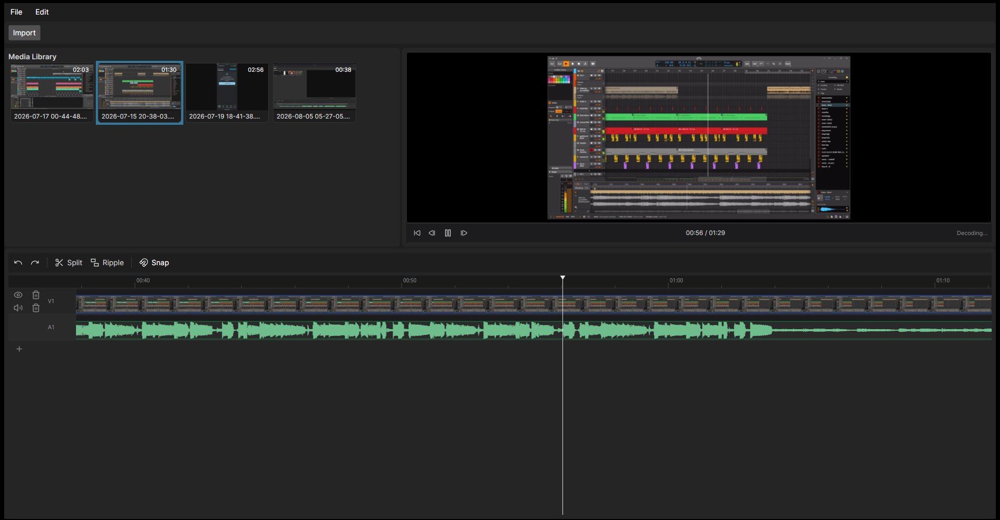

<p align="center">
  
</p>

<h1 align="center">Fig</h1>

<p align="center">
  <a href="https://github.com/Skynse/Fig/releases/latest"></a>
  <a href="https://github.com/Skynse/Fig/releases"></a>
  <a href="LICENSE"></a>
  
  
  
</p>

A simple, open-source video editor for cutting clips, long or short, without the hassle.


## Motivation
Fig is a personal project I'm working on to replace Capcut for my simple edits now that I use linux. I like to make beats, so it has features that work well for timing videos to audio tracks by bpm using fft analysis. Works well and quickly for long video captioning and editing. 

Fig also has MCP support for those who want to use agents for whatever reason (I was in a rush for something one instance and found that an agent editing clips so I could do the finishing touches after I was done working on other important tasks was useful.)




## Features

- **Timeline editing:** move, trim, split, ripple delete, with undo for everything.
- **Speed ramps:** keyframe a clip's speed, with frame blending or motion blur.
- **Effects and keyframes:** 30 effects, 20 transitions and presets, with any value keyframable. See the [creative library](docs/creative-library.md).
- **Text and layers:** titles and images, with tracks stacked top over bottom.
- **Markers:** bookmarks and ranges, and export each range as its own video.
- **Fast export:** H.264 / AAC, with hardware encoding where available.
- **Finish in DaVinci Resolve:** Fig puts a script in Resolve's Workspace ▸ Scripts menu (or use Help ▸ Install DaVinci Resolve importer). Run it in Resolve, pick a Fig project, and its timeline comes in pointing at your original media: cuts, speed, opacity, volume, crops, transitions, fades and markers, with text as transparent images. Anything that can't come over, such as Fig's effects, is listed when it finishes.

## See it in action

https://github.com/user-attachments/assets/1620a3e4-e0cc-43f5-843e-638beefd4a89

## Install

Get the latest from [Releases](https://github.com/Skynse/Fig/releases). Each is a single file with everything included.

- **Linux:** `chmod +x Fig-<version>-linux-x64.AppImage` and run it. It adds itself to your app menu. Run it with `--uninstall` to remove it from the menu.
- **Windows:** run `Fig-<version>-win-x64-setup.exe` (no admin needed), or unzip the portable `Fig-<version>-win-x64.zip` and run `fig.exe`.
- **macOS (Apple silicon):** unzip `Fig-<version>-macos-arm64.zip` and move `Fig.app` to Applications. It isn't notarized, so the first time, right-click it and choose **Open**.

## Use it with an agent

While Fig is open, it serves MCP over Streamable HTTP at `http://127.0.0.1:47331/mcp`. Requests need the bearer token in `~/.fig/mcp.json`. For a client that only starts stdio servers, give it the command `fig mcp`: it connects for you and opens Fig if it isn't running. In Claude Code:

```bash
claude mcp add fig -- fig mcp
```

## Build from source

Needs Rust (the toolchain in `rust-toolchain.toml` installs itself through rustup) and the FFmpeg development libraries.

```bash
cargo run -p fig-ui --release
cargo test --workspace
```

See [DEVELOPMENT.md](DEVELOPMENT.md) for how things fit together and [CONTRIBUTING.md](CONTRIBUTING.md) before sending changes.

## License

[GPLv3](LICENSE)
